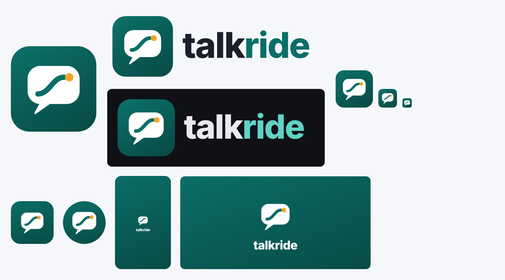

# Marca Talkride

**Talkride: habla con seguridad.** El nombre une *talk* (hablar) y *ride* (el recorrido). Talkride es el camino que haces practicando, desde tu primera grabación hasta hablar con seguridad.



## El logo

| Pieza | Archivo | Uso |
|---|---|---|
| Ícono | [`icono.svg`](icono.svg) | Ícono de la app, favicon, avatar en redes |
| Marca sola (blanca, fondo transparente) | [`marca.svg`](marca.svg) | Sobre el degradado de la marca: pantalla de inicio, ícono adaptable de Android |
| Logo horizontal, fondo claro | [`logo-claro.svg`](logo-claro.svg) | Web, documentos, presentaciones |
| Logo horizontal, fondo oscuro | [`logo-oscuro.svg`](logo-oscuro.svg) | Modo oscuro, fondos negros |
| Ícono para Google Play (512 × 512) | [`tienda-icono-512.png`](tienda-icono-512.png) | Ficha de Play Console |
| Portada para Google Play (1024 × 500) | [`tienda-portada-1024x500.png`](tienda-portada-1024x500.png) | Gráfico de funciones de Play Console |

**Qué significa.** El globo de diálogo es la conversación. La línea que sube es tu avance, y el punto ámbar es la meta: la charla, la entrevista o la reunión para la que te preparas. Por eso el «ride» se lee como recorrido y no como transporte.

**Por qué funciona a cualquier tamaño.** Tiene sólo tres formas (globo, línea y punto) y se reconoce incluso a 24 px. El petróleo oscuro transmite seriedad y el ámbar le da energía, lo que da autoridad sin ser frío.

## Colores

| Nombre | Hex | Uso |
|---|---|---|
| Petróleo | `#0b6e66` | Color principal: botones, enlaces, la línea del logo, el ícono |
| Petróleo profundo | `#084c47` | Final del degradado del ícono y de la tarjeta principal (vertical, a 160°) |
| Ámbar | `#f5a524` | Sólo el punto de la meta. No usarlo en textos ni botones |
| Tinta | `#1b1f2a` | Texto sobre fondo claro |
| Petróleo claro | `#5fd3c4` | «ride», botones y acentos en modo oscuro |

Los contrastes cumplen WCAG AA: blanco sobre petróleo es 6,1:1, y petróleo claro sobre el fondo oscuro es 10,4:1.

### Por qué petróleo y no índigo o azul

Medimos los colores reales de las 45 apps más calificadas de la categoría en la App Store de EE. UU., México y España. Fueron apps de oratoria, coach de habla, acento, entrevistas, idiomas con voz y canto. El análisis se puede repetir con [`benchmark_visual.py`](benchmark_visual.py), que corre en GitHub Actions con el flujo «Talkride benchmark visual».

| Color | Íconos (de 45) | Quiénes lo usan |
|---|---|---|
| Azul | 18 | Speeko, Vocal Image, Wellspoken, Speak, Loora, Busuu, Learna, Teams, Gemini |
| Índigo y violeta | 5, más varias pantallas | Praktika (IA), Simply Sing (voz), EWA, HelloTalk y **Cabify** (`#7145d6`, transporte). Las pantallas de BoldVoice y ELSA también son violeta |
| Verde | 5 | Duolingo (lima), SmartyMe |
| Naranja | 5 | PatterAI, Pronuncian, Orain, Gleam |
| Rojo | 4 | TED, Tone, Sing Sharp |
| Turquesa claro | 3 | Orai, ELSA y Accent Training, todos cian claro |

**Conclusiones:**

- **El índigo y violeta que tenía la primera versión era la peor opción.** Es el color de los tutores de IA y de las apps de voz, y además el de Cabify, una app de transporte. Junto a un nombre con «ride», sumaba confusión justo en Latinoamérica y España.
- **Ninguna app usa un petróleo oscuro.** Los turquesas de la categoría son cian claros, y los verdes son lima o menta.
- **El tono oscuro da autoridad, y el ámbar le da energía sin parecerse a nadie.** Tampoco se acerca a los colores del transporte: el negro de Uber, el rosa de Lyft, el violeta de Cabify y el verde claro de Bolt.

### Otras decisiones para no parecernos a nadie

- **Íconos de línea propios** en vez de emojis. Los emojis se ven distintos en cada teléfono y son el recurso más repetido de la categoría.
- **Sin llamita de racha (🔥):** es la marca de Duolingo. La racha se muestra en palabras: «Racha: 5 días seguidos».
- **Sin chispas (✨):** se volvieron el símbolo genérico de «IA». Talkride muestra lo que mide, no la tecnología.
- **Tarjeta principal sólida, de un solo tono,** en vez del degradado índigo-violeta que repiten las apps de IA.
- **El motivo propio es el camino con el punto de la meta:** está en el logo y resume la promesa del producto.

## Logotipo

- Se escribe **talkride**, en minúsculas y en negrita 800, con la fuente del sistema (SF Pro en iPhone, Roboto en Android). «talk» va en color tinta y «ride» en petróleo.
- En un texto corrido se escribe **Talkride**, con mayúscula inicial. Nunca TalkRide, Talk Ride ni TALKRIDE.
- El nombre en las tiendas es «Talkride: habla con seguridad». En inglés, «Talkride: Speak with Confidence».

**Qué no hacer:**

- Cambiar los colores del ícono.
- Ponerle sombras o contornos.
- Girarlo.
- Poner el ícono sobre fotos con mucho detalle.
- Separar el globo de la línea.

## Regenerar los íconos

Todos los PNG salen de `icono.svg` y `marca.svg`: web, Android (ícono normal, redondo y adaptable), iPhone (1024 × 1024 opaco), pantallas de inicio y tiendas. Si cambias el logo, edita los SVG y corre:

```bash
node voxa/docs/marca/generar.cjs
```

## Nombres internos que no cambian

La carpeta `voxa/`, las variables de entorno `VOXA_*`, la cabecera `X-VOXA-User` y las claves que la app guarda en el teléfono (`voxa.*`) siguen como estaban, porque nadie las ve:

- **Variables de entorno:** cambiarlas obligaría a volver a configurar Render, GitHub y RevenueCat, y dejaría el servidor sin claves hasta hacerlo.
- **Claves del teléfono:** cambiarlas borraría el progreso que ya guardaron quienes prueban la app.
- **Servicio de Render:** se sigue llamando `voxa`, y la dirección https://voxa-kfg6.onrender.com no cambia. Si se renombra en el Blueprint, Render crea un servicio nuevo, sin el disco ni las claves.
